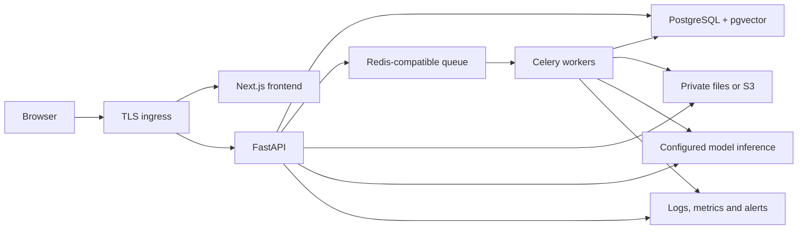

# NexusAI Part 3 · Production readiness audit

25 November 2026. Stage 1 only. This audit examined the workspace, Part 1 and Part 2 records, source, dependency declarations, and available tooling. The user previously directed that testing run on a server. No authorized test server, test database, or linked NexusAI repository was identified. Docker's engine was unreachable in this Windows session.

## Existing structure and verification

```text
NexusAI/
  backend/app/        FastAPI app, API, settings, errors, logs, database, schemas
  backend/tests/      Two Pytest source files
  docs/               Architecture, audits, API, schema, verification and development records
  README.md           Server setup and verification commands
  pyproject.toml      Direct dependency pins and test configuration
  .env.example       Example settings with an empty database URL
  .gitignore
```

The directory has no Git metadata, dependency lockfile, or project-local virtual environment. A read-only search of connected GitHub installations found no repository matching NexusAI.

| Area | Classification | Audit finding |
| --- | --- | --- |
| Part 1 API startup, health, status, settings, OpenAPI, errors and logging | Implemented but unverified | Source defines the application factory, `/health`, `/ready`, `/api/v1/status` and documentation routes. Startup and response checks are pending. |
| Part 1 PostgreSQL | Partially implemented. Live verification blocked. | SQLAlchemy pool, timeouts and `SELECT 1` readiness probe exist. A disposable test database is needed. Alembic migrations, pgvector and application tables are missing. |
| Part 1 auth and workspace authorization | Missing | Registration, login, roles, and isolation controls and tests are absent. |
| Part 1 document knowledge | Missing | Upload, ingestion, chunking, embeddings, keyword and vector retrieval, RAG, citations and history are absent. |
| Part 1 frontend and retrieval evaluation | Missing | No frontend build, API integration, reviewed relevance corpus, benchmark runner or results. |
| Part 2 workflows and agents | Missing | No LangGraph project workflow, checkpoint integration, agent code, SQL analytics or approval and cancellation flows. |
| Part 2 training and inference | Missing | No datasets, trained ML or deep learning artifacts, MLflow registry, adapters, evaluation results or inference service. |
| Part 2 verification, reporting and frontend | Missing | No verification service, report generation or workflow UI. |
| Part 3 deployment and operations | Missing | No Dockerfiles, Compose, Terraform, workflows, deployed service, production dashboards, backup drill, security scans or load results. |
| Existing automated checks | Implemented but unverified. Execution blocked. | Twelve backend application tests and one PostgreSQL integration test are defined. No lint, test, startup, scan, build or load results were recorded. |

**Actual automated results for this audit: zero runs.** There are no observed passes, failures, skips, or performance measurements. A source-defined endpoint is evidence of implementation. It cannot establish that dependencies resolve, the server starts, or a request succeeds.

## Environment and deployment blockers

- Windows 11 x64 build 29708 and Python 3.13.1. Intel Core i5-8265U, four physical cores and eight logical processors.
- 7.85 GiB usable RAM, about 0.80 GiB available at inspection. NVIDIA MX250 with 2 GiB VRAM and driver 516.40.
- Free disk was 16.6 GiB on C:, 57.9 GiB on D:, and 95.4 GiB on E:. The workspace resides on C: under OneDrive.
- SSH, Docker CLI and Git were found. AWS CLI, Terraform and psql were absent from PATH. Docker reported inaccessible client configuration and an unavailable daemon pipe. No SSH config file was present at the standard user path.
- A designated server or authorized remote CI runner can verify the current API. A disposable PostgreSQL server is needed for the integration test. The missing application components cannot be verified until implemented. Part 3 needs an approved repository destination, target region, infrastructure option, and budget before any corresponding external work.

Start server verification by resolving and recording `uv.lock`, then run Ruff, the 12 application tests, the marked PostgreSQL integration test and live Uvicorn smoke checks. Confirm `/health`, `/api/v1/status`, and OpenAPI return HTTP 200, `/ready` returns HTTP 503 without a usable database and HTTP 200 with one, and an invalid status query returns the documented HTTP 422. Keep output in the test report. Use the [README server commands](../README.md#server-setup-and-verification).

## Security and dependency findings

These are source and configuration observations for deployment planning. A resolved dependency scan and live security validation remain pending.

| Priority | Finding and proposed response |
| --- | --- |
| Release blocker | Workspace auth and data authorization are missing. Apply server-side workspace isolation to data access and test with two independent users before exposing user data. |
| High before public exposure | Readiness and the optional status database probe can open a database connection on unauthenticated requests. Limit these probes to internal infrastructure or protected access and rate-limit public endpoints. |
| Medium before public exposure | API docs default to enabled and the environment setting defaults to development. Require explicit environment configuration on deployment and disable or restrict documentation there. |
| High for private cloud data | The application accepts a database URL and does not require certificate verification in a production profile. Require verified PostgreSQL TLS when using the managed database. Inject credentials at runtime and apply separate migration and application roles. |
| Verification gap | Direct pins do not capture the resolved transitive dependency tree. Generate a lockfile, audit it on the test runner, and scan built images. Record findings with package versions, severity and remediation. |
| Future implementation gates | Validate upload types and limits, contain storage access, restrict agent tools and external requests, enforce read-only SQL access and verify AI evidence and tenant boundaries. These controls apply when the corresponding features exist. |

Existing source uses a blank example database credential, a redacted settings type, bounded database timeouts, generic server error responses and request correlation IDs. Preserve those patterns and confirm their runtime behavior on the server.

## Recommended production architecture



The ingress serves the frontend and routes API traffic under the same origin. FastAPI checks workspace membership and manages jobs. Workers ingest documents, execute workflows and build reports. PostgreSQL holds durable job state and checkpoints. A transactional outbox publishes work to the queue, and idempotency keys protect retried jobs. Authorized requests resolve private storage references or receive short-lived downloads. Keep training on a separate approved machine. Add an inference service only if measured CPU contention or model memory warrants it.

Use isolated configuration and storage for local development, automated tests, staging and production. Plan CloudWatch for AWS logs and alerts, with OpenTelemetry when cross-service traces are needed. Avoid parallel monitoring stacks for the initial release.

### Docker plan

Build versioned, multi-stage images with non-root users and dependency locks. Use distinct Next.js and Python images. Reuse the Python build for API and worker commands while their runtime dependencies fit. Compose should launch a reverse proxy or frontend, API, worker, PostgreSQL with pgvector, Redis-compatible broker and optional inference profile. Keep database data and model caches on named volumes. Use disposable test volumes, runtime secrets, internal readiness checks, resource limits, graceful worker shutdown and a separately invoked migration job. Confirm startup from an empty test environment and record image sizes and readiness times.

### CI/CD plan

On pull requests, run Ruff, backend tests with disposable PostgreSQL, frontend lint and build, Playwright smoke tests and dependency and image scans. Run containers as CI artifacts before publication. Build immutable digests and publish to ECR only from an authorized workflow. Use scoped GitHub OIDC, separate staging and production roles, a staging migration and smoke test, and approval before promoting the same image digest. Confirm whether the repository plan supports required reviewers. Otherwise use a separately controlled manual deployment with restricted credentials. Rehearse image rollback and use backward-compatible database migrations. [GitHub AWS OIDC](https://docs.github.com/en/actions/how-tos/secure-your-work/security-harden-deployments/oidc-in-aws) · [Deployment protection rules and plan requirements](https://docs.github.com/en/actions/how-tos/deploy/configure-and-manage-deployments/manage-environments)

## AWS planning estimates

Reference region is US East (N. Virginia), `us-east-1`. USD estimates use 730 hours per month, on-demand capacity and no free-tier assumption. The region is a pricing reference pending user selection. Costs are estimates and there is no cloud bill or resource inventory for this audit.

| Option | Assumptions | Estimated monthly base |
| --- | --- | --- |
| A · Single-host portfolio deployment | EC2 Linux `t3a.large`, 2 vCPUs and 8 GiB RAM at $0.0752/hour. Nginx and Compose with on-host PostgreSQL and broker. 40 GB gp3 at $0.08/GB-month, one public IPv4 address at $0.005/hour, and 10 GB S3 Standard at $0.023/GB-month. The host is a single point of failure. Test burst credits and memory under load. | **About $62** before usage charges. |
| B · Managed services | Three ECS/Fargate services totaling 2 vCPU and 4 GiB across one task per service, about $72. Single-AZ RDS PostgreSQL `db.t4g.medium` with 20 GB storage, provisional $50 allowance pending the regional quote. ALB base $16.43, two public IPv4 addresses $7.30, one NAT gateway plus its IPv4 address $36.50, a minimum-size ElastiCache Serverless for Valkey cache about $6, and approximately $0.43 for 10 GB S3 plus 2 GB ECR storage. Validate the broker's managed-cache compatibility and benchmark worker sizing before selection. | **About $189** before usage charges. One task per service, one NAT gateway and Single-AZ RDS are cost assumptions. Redundancy increases cost. |

Ingress traffic and object retrieval affect usage. Add outbound and inter-AZ transfer, load balancer usage, NAT processing, S3 requests, logs, snapshots, secrets, burst credits, additional environments, tax and any domain charges to the estimate. LLM API costs depend on input, output and embedding consumption at an approved provider's rates. No GPU or paid inference is included. Quote a short GPU job separately if approved, using its instance rate times runtime plus storage and transfer. Reprice the RDS allowance, networking and inference after the region and workload are selected. [EC2 T3a](https://aws.amazon.com/ec2/instance-types/t3/) · [EBS](https://aws.amazon.com/ebs/pricing/) · [S3](https://aws.amazon.com/s3/pricing/) · [S3 estimate assumptions](https://aws.amazon.com/calculator/calculator-assumptions/) · [RDS PostgreSQL](https://aws.amazon.com/rds/postgresql/pricing/) · [RDS pgvector compatibility](https://docs.aws.amazon.com/AmazonRDS/latest/PostgreSQLReleaseNotes/postgresql-extensions.html) · [Fargate, ALB and NAT sample rates](https://docs.aws.amazon.com/solutions/latest/prebid-server-deployment-on-aws/cost1.html) · [Public IPv4](https://aws.amazon.com/vpc/pricing/) · [ElastiCache](https://aws.amazon.com/elasticache/pricing/) · [ECR](https://aws.amazon.com/ecr/pricing/)

Recommend Option A only after a working build meets low-concurrency resource targets. Provisioning remains subject to approval. For the existing backend alone, target a Linux test runner with 2 vCPUs, 4 GiB RAM and 10 GiB free disk as a starting estimate. For the integrated build with CPU embedding and one worker, plan 4 vCPUs, 8–16 GiB RAM and 25–40 GiB disk for staging. Benchmark local inference separately before colocating it. Track every provisioned resource, its owner, dependencies and cleanup procedure. Budget alerts can warn about spending and may arrive after charges accrue. [AWS Budgets](https://docs.aws.amazon.com/cost-management/latest/userguide/budgets-managing-costs.html)

## Part 3 stages and acceptance gates

| Stage | Acceptance gate |
| --- | --- |
| 1 · Audit | Inventory, gap analysis, source risks and deployment estimates documented. Runtime verification remains blocked. |
| 2 · Architecture and environments | Configuration contracts, diagram, environment isolation, secrets and feature flags reviewed. Invalid environment combinations fail predictably. |
| 3 · Docker | Build non-root images, start clean Compose stack, and record image digests, sizes and startup times. |
| 4 · Jobs | Demonstrate progress, deadlines, cancellation, bounded retry and worker restart without duplicate or partial outputs. |
| 5 · Database and storage | Verify migrations, isolation, storage permissions, vector recall and latency trade-offs, and restore to disposable infrastructure. |
| 6 · Security | Resolve release-blocking findings and record authorized defensive test results and remaining risks. |
| 7 · Model serving | Serve an approved model version and verify validation, timeouts, resource use, prediction consistency and rollback. |
| 8 · AI performance | Measure RAG and agent baselines, apply targeted changes, and repeat the same evaluation with quality gates. |
| 9 · Frontend | Verify all visible workflows against real APIs, including desktop and mobile accessibility and failure states. |
| 10 · AWS selection | Refresh both cost models for the chosen region, confirm workload and monthly budget, and obtain approval before provisioning. |
| 11 · Terraform | Check formatting and validation, review the plan and state handling. Apply and destroy require explicit approval. |
| 12 · CI/CD | Demonstrate checks, image integrity, staging approval and rollback, with authorized credentials and repository permissions. |
| 13 · AWS deployment | After approval, deploy the selected resources. Record actual URL, TLS, image versions, migrations and smoke-test outputs. |
| 14 · Observability | Verify redacted logs, correlation, metrics, dashboards and alert delivery across the API and worker. |
| 15 · Load | Run bounded staging tests and record p50/p95/p99, throughput, error rate and resource bottlenecks. Recheck after any changes. |
| 16 · End to end | Verify account creation, workspace, uploads, RAG evidence, agent research and SQL, registered prediction, verification, report download and logs. Run isolation and recovery checks. |
| 17 · Portfolio documentation | Reproduce setup and operations from documentation. Include real screenshots and results. Obtain license and publication approval. |
| 18 · Resume and interview | Produce the project entry, at least 30 questions and answers, a two-minute introduction and a five-minute demo script grounded in verified features. |

The next recommended authorized work is to designate a test server and verify the existing backend, then resume Part 1's staged implementation. Finish the Part 1 and Part 2 capabilities that Part 3 depends on before packaging a release. Part 3 Stage 2 requires approval. AWS region, budget, infrastructure execution, repository publication, paid inference and GPU work each require approval before the related action.
